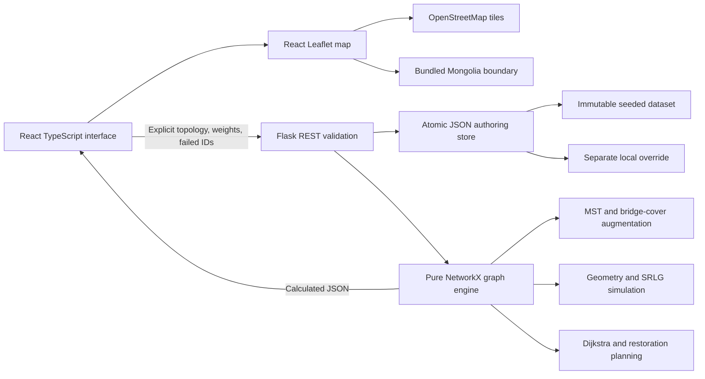

# FiberGuard Mongolia — academic technical documentation

## Research objective

Study the economic and structural trade-off between minimum-cost connectivity, single-edge resilience, and correlated geographic hazards for a 22-city Mongolian planning graph. The software makes graph-theoretic guarantees only about the authored graph, and keeps planning estimates separate from surveyed infrastructure facts.

Research questions:

1. What does a minimum-cost connected topology cost under a declared engineering model?
2. What additional candidate links eliminate every bridge, and what additional cable / CAPEX results?
3. Why can a 2-edge-connected network still fail under regional or shared-corridor hazards?
4. How do transparent risk weights change the selected augmentation and modeled routing outcomes?

## Software architecture



Modules isolate REST / validation, persistence, graph algorithms, geometry, and UI. Baseline graphs are reconstructed from snapshots. Simulations copy graphs and remove specified links; they never modify the candidate graph. React maintains explicit per-tab failure state and passes it in every simulation / route request. Weighted optimization is deterministic and is reapplied using the submitted weights, avoiding server-side global configuration conflicts.

Authored infrastructure is different from simulation state. A node or corridor edit persists to `data/network.local.json` via temporary-file replacement under a reentrant lock; it increments a revision and invalidates the baseline topology cache. Simulation reset never deletes infrastructure. The store supports one server process; multiple writers across processes require migration to a transactional database.

## Road-following extension (default dataset)

The initial coordinate-only estimate has been replaced as the **default** by a stored OSRM / OpenStreetMap road snapshot covering all 45 candidates. `network.roads.json` is loaded before `network.json` when no local authoring override exists. The original deterministic estimate dataset remains available as an explicitly identified fallback and as a stable test fixture; the coordinate formulas below apply only to that estimate source.

For each authored adjacency, the updater requests the provider's fastest car route with full GeoJSON geometry and a 1 km endpoint snap limit. Provider `[longitude,latitude]` coordinates are converted to `[latitude,longitude]`. Scalar road distance is taken directly from the provider (meters / 1000), without a terrain detour multiplier. Cost still uses declared terrain rates and latency still uses optical propagation speed. Driving time is metadata, not fiber latency.

Full geometry is simplified using iterative Douglas–Peucker with 20 m tolerance in local projected coordinates. Map rendering and regional intersection use that stored road shape. Scalar length remains the full provider distance, rather than the length of simplified chords. The route record stores request URL, provider, timestamp, optional graph data version, snapping distance and tolerance. The stored sample points for all 45 fetched routes lie within the bundled coarse Mongolia outline; this is a visual orientation check, not legal/survey border validation.

The public service receives at most one new request every 1.1 seconds and route results are persistently cached by endpoints, server and profile. A failed or malformed route raises an explicit error; no straight line is fabricated. An atomic apply step rejects stale node coordinates or protected surveyed lengths and updates geometry, distance, CAPEX and latency together. The original baseline remains unchanged. `POST /network/edges/:id/road-route` powers per-edge refresh in the data table; `python -m scripts.fetch_roads` builds the offline snapshot (add `--refresh` to bypass cache).

This is an OSM car alignment, **not a guarantee of asphalt-only road surface, cable ownership, cable installation, or construction permission**. OSRM selects fastest driving time, not minimum distance or a paved-only objective. Link-length and CAPEX sums include each logical cable independently, without deduplicating trenches or applying shared-construction discounts. Two logical candidate links may share actual roads or pass through another modeled city. Consequently graph edge-disjointness does not imply physical route independence; geographic correlated-failure tests remain necessary. Shared-risk group assignments are still authored assumptions rather than automatically surveyed conduit groups. Full Mesh remains theoretical and direct.

Sources: https://project-osrm.org/docs/v26.4.0/http and https://routing.openstreetmap.de/about.html. Geometry attribution: OpenStreetMap contributors / ODbL.

## Geographic and engineering model

A node contains a stable ID, Mongolian name, English name, province, latitude, longitude, node type, and modeled demand. Coordinates use WGS84 latitude / longitude ordering `[lat, lon]`. Ulaanbaatar (`ub`) is the reference node and cannot be deleted through the UI/API.

The 45 fiber-planning candidate adjacencies are explicit planning hypotheses in `data/generate.py`. None is represented as verified infrastructure. Western, central, southern, and eastern regions are used to produce deterministic correlated-risk groups. Corridor IDs, terrain classifications, regional exposure, risk scores, demand, are simulated metadata. Road-snapshot geometry is externally routed, whereas fallback geometry is simulated. The generator has no random side effects; the stress-suite pair selection uses seed 42.

### Length and CAPEX

For latitudes φ and longitude difference Δλ in radians:

```text
h = sin²((φ₂−φ₁)/2) + cos(φ₁) cos(φ₂) sin²(Δλ/2)
d_geo = 2 R asin(sqrt(h)), R = 6371.0088 km
D = round(d_geo × terrain_detour, 3)
C = round(D × deployment_rate, 2)
```

| Terrain | Detour | Modeled USD/km |
| --- | ---: | ---: |
| Steppe | 1.15 | 17,500 |
| Mountain | 1.28 | 23,500 |
| Gobi | 1.12 | 15,000 |

The scalar detour-adjusted cable length and synthetic display polyline are separate estimates. The display line is not a verified road, railway, right-of-way, or cable alignment. Costs are teaching assumptions, not procurement prices or financial guidance.

To replace an estimate, update the edge with `distance_source=validated_route`, a positive surveyed `distance_km`, positive deployment `cost_usd`, and a `validation_reference`. Set actual geometry and its provenance separately if available. Endpoints must match existing nodes within 1 km. When a node moves, estimated incident routes are recalculated; validated incident routes must be reclassified / revalidated first.

## Algorithms and guarantees

### Minimum spanning tree

`networkx.minimum_spanning_tree(..., weight='cost_usd', algorithm='kruskal')` sorts candidate edges by deployment cost and joins different components. In the connected seeded graph, the result has `|V|−1 = 21` edges. Cost and distance differ by terrain rate, so this is a **cost MST**, not a claim to minimize both cost and length simultaneously.

Kruskal is O(E log E), with near-constant amortized union-find operations. A disconnected candidate graph produces an explicit infeasibility result instead of displaying a minimum spanning forest as a connected national network.

### Bridges

`networkx.bridges` identifies edges whose deletion increases the number of connected components. NetworkX 3.2.1 uses chain decomposition, not a direct implementation of Tarjan low-link DFS. Both test the same graph-theoretic bridge condition in linear time for a simple undirected graph. This implementation does not misattribute NetworkX's implementation to Tarjan.

Every tree edge is a bridge. A connected undirected graph with at least two nodes is 2-edge-connected exactly when it has no bridges. Vertex / node connectivity is a separate property and is not claimed here.

### Cost-aware augmentation

Feasibility precondition: the **entire candidate graph** is connected and bridge-free. If the full candidate graph contains a bridge, no subset can eliminate it; the API returns HTTP 422 for explicit augmentation requests. Topology listing returns a structured `infeasible` result for the affected topology so infrastructure editing remains available.

Algorithm:

```text
H ← cost MST of G
while H has bridges:
    for every candidate e=(u,v) outside H:
        P ← existing shortest-distance path from u to v in H
        k ← number of current bridges along P
        skip if k = 0
        score ← normalized cost(e) / k
    add the candidate with lowest (score, stable edge ID)
for each added edge in reverse insertion order:
    remove it if H remains connected and bridge-free
explicitly remove each surviving H edge one at a time and check connectivity
```

Adding an edge closes a cycle covering every bridge on its endpoint path. Existing nonbridge cycles do not invalidate the bridge-cover count. The process terminates because it only adds edges from a finite feasible candidate graph. Reverse deletion removes redundant additions while retaining the starting MST. The certificate reports checked edges, passed edges, and failed edge IDs.

This is a deterministic weighted set-cover-style heuristic. It does **not** prove the minimum total augmentation cost. Reverse deletion is inclusion-minimal only relative to the added-edge removal order while retaining the initial MST. Risk augmentation may happen to find a cheaper topology than cost augmentation.

For n=22, m=45, repeated Dijkstra and bridge calls are small. A conservative bound is O(m² × (m+n log n)) for greedy scans plus O(m(m+n)) verification / deletion; this favors clear reasoning over a specialized large-network solver.

### Risk-weighted augmentation

The starting tree remains the cost MST. Only augmentation candidate ranking changes:

```text
S(e) = [w_cost × C(e)/Cmax
      + w_terrain × risk(e)
      + w_exposure × exposure(e)
      + w_diversity × SRLG_path_overlap(e)
      + w_latency × D(e)/Dmax] / newly_covered_bridges(e)
```

`SRLG_path_overlap` is the fraction of existing endpoint-path edges sharing the proposed link's SRLG. Higher weight penalizes correlated backup cycles. `D/Dmax` is a backup-link-length / propagation proxy, not a proof of minimum worst-case post-cut end-to-end latency. Terrain risk and disaster exposure are authored dimensionless scores in [0,1]. Weights are finite values in [0,5], with at least one positive value. The UI exposes 0–3 for convenient adjustment.

This heuristic combines preferences with different meanings; it does not constitute a probabilistic risk model. Increasing a preference can change a greedy decision and later topology, but it does not guarantee monotonic improvement of the corresponding global metric.

### Full mesh

The complete graph has n(n−1)/2 = 231 links for n=22. Every pair receives a theoretical direct haversine length and a uniform teaching rate of $17,500/km. `theoretical=true`, `distance_source=haversine_direct`, and a separate ID namespace distinguish these from candidate infrastructure. The mesh is not inserted into optimization feasibility or physical corridor records. Regional stress-suite survival is N/A for this benchmark.

### Dijkstra and latency

NetworkX Dijkstra minimizes summed **cable distance**, using nonnegative distances. Before / after results include route node IDs and surviving edge IDs. Unreachable destinations have `reachable=false`, empty routes, and `null` latency / distance values.

```text
Propagation one-way (ms) = D_km / 200
Propagation RTT (ms) = D_km / 100
Equipment one-way (ms) = hops × 0.15
Modeled total RTT (ms) = D_km / 100 + hops × 0.30
```

The maximum modeled RTT is calculated across shortest-distance paths for all node pairs. The `<50 ms` threshold is false if the graph is disconnected, with a null global maximum; maximum reachable-pair RTT is reported separately. These figures exclude traffic congestion, serialization, queueing, access networks, transponders beyond the declared per-hop estimate, and measured hardware behavior. They are not real RTT measurements.

## Disaster methodology

### Single and cumulative cuts

The request provides a topology, selected edge ID, and optional prior `failed_edges`. Every failed ID must exist in the selected topology. The server removes their union from a fresh copy. Repeated UI cuts accumulate; restoring one link removes its ID and recalculates. Switching topologies resets simulation state to avoid carrying incompatible edge IDs between graphs.

### Regional floods and earthquakes

Both are deliberately simple regional stress models:

1. Select center `[latitude, longitude]` and radius in kilometers.
2. Multiply base radius by severity (0.25–2). Severity is a radius multiplier, not an earthquake magnitude / physical flood depth.
3. Project each stored road / explicitly estimated polyline segment into local equirectangular kilometer coordinates centered at the event.
4. For segment endpoints A and B, find the closest point to origin:

```text
t = clamp(−A·(B−A) / |B−A|², 0, 1)
Q = A + t(B−A)
affected ⇔ |Q| ≤ effective_radius
```

5. Fail the whole edge if any segment intersects the circle, including cases where both endpoints are outside it.

This projection is approximate, particularly at very large regional radii and high latitudes. It is not a cadastral buffer, geodesic hazard boundary, floodplain, seismic attenuation model, or forecast. The full modeled polyline is tested; testing city endpoints only would miss important cuts.

The displayed circle previews the current controls. Failed edges remain accumulated from completed runs, so they may lie outside the next preview circle. The latest response includes the actual executed `zone` and its effective radius for reports.

### Shared-risk link groups

Triggering a nonempty group fails every selected-topology edge assigned to that group. Groups encode hypothetical common corridor / region exposure. A graph can have two edge-disjoint paths that cross the same flooded valley or share a conduit. Thus bridge-free topology alone cannot establish geographic independence.

### Connectivity and rerouting

All nodes remain in the graph. Connected components are calculated after failure. Affected cities are those outside Ulaanbaatar's surviving component. Availability is:

```text
100 × |nodes reachable from reference| / |all modeled nodes|
```

Dijkstra is recalculated for every destination. Changed / unreachable paths are returned in `rerouted_paths`; an example surviving alternative is highlighted on the map. With multiple disconnections, each unreachable destination remains explicitly unreachable. No artificial teleporting or fabricated backup route reconnects components.

### Recovery

Contract surviving connected components. Sort the entire authored candidate graph by `(deployment cost, edge ID)` and perform Kruskal union operations across components. Selected failed baseline links imply restoration; selected previously unbuilt candidate links imply construction. Sum full edge CAPEX as a transparent **replacement / build proxy**. This minimum component-joining cost is exact for that additive candidate-cost model, while the earlier 2-edge augmentation remains heuristic.

The restoration plan is post-event planning and requires hazard clearance and field validation; it is not an immediate intervention or a claim that a corridor through an active disaster is buildable. Repair costs and recovery time are unknown. The plan restores basic connectivity, not necessarily the previous level of redundancy. It is a recommendation only and does not mutate the graph.

## Evaluation methodology

Single-edge survival is the proportion of all existing links whose individual deletion leaves every node connected. A disconnected starting graph receives 0%. Bridge count provides the mathematical equivalence, and serialized topologies also include exhaustive removal certificates.

The correlated / multiple-failure suite uses the **same candidate inventory** for all physical topologies:

- Circles at [47.918,106.917] / 120 km, [48.3,94.5] / 160 km, and [46.4,111.5] / 180 km.
- One simultaneous failure for every nonempty SRLG.
- Thirty unique candidate-link pairs from a deterministic shuffle with Python `Random(42)`.

A case succeeds only if **all nodes** remain connected. Cases may remove fewer than two selected links if the corresponding candidate infrastructure was not built; this is intentional equal-hazard comparison. No-effect cases are included for every topology. The percentage is a finite suite score, not failure probability, uptime, or a guarantee under all pairs / disasters. With the default four groups, the suite has 37 cases. Full mesh has no asserted physical shared-risk geometry, so it is excluded.

## Validation and reproducibility

The backend suite tests dataset integrity; connected 21-edge MST; bridge count; both augmented topologies; explicit deletion of every augmented edge; deterministic output; infeasibility; tree bridge cuts; nonbridge cuts; segment-interior intersection; exact disaster hit IDs; surviving-only rerouting; null unreachable latency; propagation and CAPEX arithmetic; 231-edge mesh separation; common stress inventories; candidate-only restoration; immutable baseline; REST validation, CRUD, persistence, and reset.

The browser suite tests seven end-to-end workflows, including mobile overflow and real download initiation. Tests can run against automatically launched local servers. Browser screenshots and traces are written to ignored `frontend/test-results/`.

Reproduce the original coordinate-estimate baseline with `python3 data/generate.py` (this rewrites only the seeded file deterministically). Remove local authoring overrides and restart the backend to evaluate the default road snapshot table. Live road data may change; the committed snapshot makes the published results reproducible. Dependency pins and the frontend lockfile make installation reproducible.

## Deliberate limitations and next research steps

There is no exact integer-programming augmentation solver, verified real-world cable inventory, live telemetry, hydrological / seismic forecast integration, capacity-constrained traffic assignment, node failure modeling, repair scheduling, multiuser authorization, or persistent simulation audit database. The working simpler alternatives are documented weighted augmentation, deterministic circle / SRLG stress tests, explicit per-tab simulations, proxy deployment costs, and locally authored data.

A defensible next step is obtaining validated corridors and cost evidence before increasing optimization complexity. Thereafter: ILP lower bounds / optimality gaps, GIS geodesic impacts and hazard rasters, true corridor independence, demand-weighted services, capacity-aware routing, probabilistic reliability calibrated with historical faults, PostGIS persistence, and authenticated collaboration.
